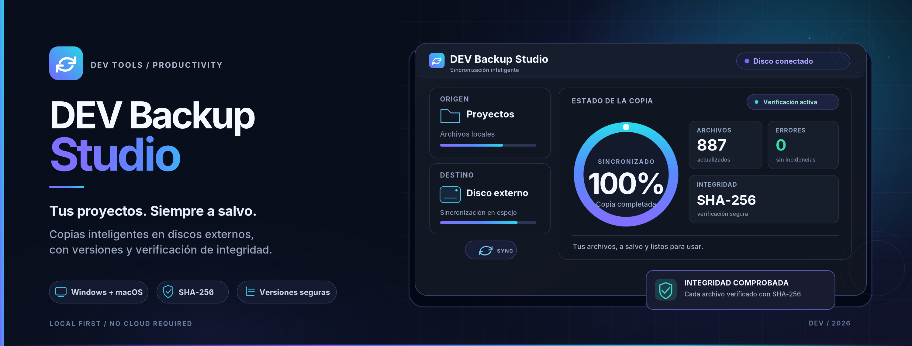
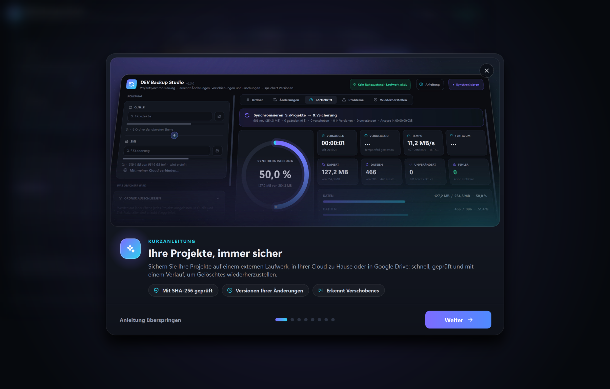

<p align="center">
  
</p>

<p align="center"><a href="README.md">Español</a> · <b>Deutsch</b></p>

Sicherung und Synchronisierung von Projektordnern auf ein externes Laufwerk, in Ihre Cloud zu Hause
oder in Google Drive, für Windows, macOS und Linux. Erkennt, was sich geändert hat, verschiebt
Umbenanntes, statt es erneut zu kopieren, bewahrt Versionen dessen auf, was Sie löschen oder ändern,
prüft jede Kopie mit SHA-256, läuft von selbst zur gewählten Uhrzeit und fragt, ob synchronisiert werden
soll, sobald Sie das Laufwerk anschließen. Außerdem sichert sie Ihr Google Drive auf ein Laufwerk.

## Herunterladen und installieren

Unter [Releases](https://github.com/crazyramirez/dev-backup-studio/releases/latest):

| System | Datei | Installation |
|---|---|---|
| Windows 10/11 (64 Bit) | `DEV-Backup-Studio-Setup-x.y.z.exe` | Installationsassistent. Standardmäßig nur für Ihr Benutzerkonto, ohne Administratorrechte; legt eine Verknüpfung im Startmenü an (auf Wunsch auch auf dem Desktop) und wird unter *Einstellungen → Apps* deinstalliert. |
| macOS 12+ (Apple Silicon) | `DEV-Backup-Studio-x.y.z-macOS.dmg` | Die `.dmg` öffnen und die App in *Programme* ziehen. |
| Linux x86_64 (Ubuntu 22.04+, Debian 12+, Fedora 36+ …) | `DEV-Backup-Studio-x.y.z-x86_64.AppImage` | Eine einzige Datei, ohne Installation: an einem beliebigen Ort speichern (z. B. `~/Anwendungen`), ausführbar machen (*Eigenschaften → Als Programm ausführen* oder `chmod +x`) und öffnen. Beim ersten Start trägt sie sich selbst ins Anwendungsmenü ein. |

Zum Aktualisieren die neue Version einfach darüber installieren: Ist die App geöffnet (auch im
Infobereich), bittet der Assistent darum, sie zu schließen. Einstellungen, Indizes und Sicherungen
bleiben erhalten, auch beim Deinstallieren. Die App meldet neue Versionen und aktualisiert sich auf
Wunsch selbst (unter Linux ersetzt sie die `.AppImage` dort, wo sie liegt).

Unter Linux funktioniert der Infobereich in KDE, XFCE, Cinnamon, MATE und Ubuntu; im unveränderten
GNOME wird die Erweiterung *AppIndicator* benötigt. Ohne Infobereich startet die App mit der Sitzung
minimiert. Zum Entfernen: die `.AppImage`, `~/.local/share/applications/dev-backup-studio.desktop`
und, falls aktiviert, `~/.config/autostart/dev-backup-studio.desktop` löschen.

Die Apps sind nicht mit einem Entwicklerzertifikat signiert, daher warnt das System beim ersten Start:

- **Windows** (SmartScreen): *Weitere Informationen* → *Trotzdem ausführen*.
- **macOS**: Rechtsklick auf die App → *Öffnen*, oder *Systemeinstellungen → Datenschutz & Sicherheit
  → Dennoch öffnen*.


## Was die App kann

- **Spiegel-Synchronisierung mit Versionen.** Das Ziel wird zum genauen Abbild der Quelle. Was Sie
  ändern oder löschen, geht nicht verloren: Die vorherige Version wandert auf dem Sicherungslaufwerk
  nach `.devbackup/versiones/<Datum>/` und bleibt so lange erhalten, wie Sie wählen (7, 30 oder
  60 Tage). Danach wird sie automatisch entfernt – bei Platzmangel auch früher, die ältesten zuerst.
- **Wiederherstellen wie mit einer Zeitmaschine.** Der Tab *Wiederherstellen* zeigt das Beiseitegelegte
  nach Datum (heute, gestern, diese Woche, nach Monaten) oder alles zusammen, mit Suche und den Filtern
  *Gelöscht* und *Frühere Versionen*. Ein Klick legt Dateien oder ganze Ordner an ihren Platz in der
  Quelle zurück oder in einen anderen Ordner. Es wird nie etwas überschrieben: Gibt es bereits eine
  andere Datei mit diesem Namen, wird die Version daneben als
  `Name (wiederhergestellt <Datum>).ext` gespeichert.

  

- **Schutz vor Massenlöschungen.** Würde eine Synchronisierung einen großen Teil der Sicherung
  beiseitelegen (etwa weil die Quelle leer erscheint oder ein Laufwerk nicht richtig verbunden ist),
  hält sie an, bevor sie etwas anrührt, zeigt, welche Ordner verschwinden würden, und fragt nach.
- **Erkennt Verschobenes und Umbenanntes.** Ein umbenannter oder in einen anderen Unterordner
  verschobener Ordner wird auf dem Laufwerk in Sekunden verschoben, statt erneut kopiert zu werden –
  auch mit doppelten Dateien (mehrere leere `__init__.py`, `.gitkeep` …) und selbst ohne eine einzige
  eindeutige Datei. Von Hand ausgeschlossene Unterordner bleiben unter dem neuen Namen ausgeschlossen,
  und eine reine Änderung der Groß-/Kleinschreibung (`projekt` → `Projekt`) wird ebenfalls übernommen.
- **Lässt weg, was sich neu erzeugen lässt.** `node_modules`, `.venv`, `__pycache__`, `dist` … per Name
  auf jeder Ebene, oder einzelne Ordner durch Entfernen des Hakens im Baum.
- **Erkennt das Laufwerk beim Anschließen.** Die App bleibt im Infobereich (unter macOS in der
  Menüleiste) und analysiert beim Einstecken des Laufwerks, was neu, geändert, verschoben oder gelöscht
  ist, bevor irgendetwas kopiert wird. Sie erkennt es auch, wenn Windows einen anderen
  Laufwerksbuchstaben vergibt.
- **Prüft jede Kopie.** Jede kopierte Datei wird vom Laufwerk neu gelesen, am Systemcache vorbei, und
  ihr SHA-256 mit dem Original verglichen. Stimmt er nicht überein, wird erneut kopiert.
- **Prüft die Integrität des Laufwerks nach und nach.** Nach jeder Synchronisierung und für die gewählte
  Dauer (standardmäßig 5 Minuten, auch bei einer halb gelesenen riesigen Datei nicht länger) prüft sie
  einen Teil der bereits kopierten Dateien auf stille Beschädigung: zuerst die noch nie geprüften, dann
  die vor mehr als 30 Tagen geprüften. Ist das Ziel beschädigt, wird es aus dem Original repariert; ist
  es das Original, warnt die App und lässt die gute Kopie unangetastet. Die Prüfung lässt sich jederzeit
  überspringen: Die Sicherung ist bereits vollständig.
- **Genauer Fortschritt und Zusammenfassung am Ende.** Prozent, Tempo, Restzeit, voraussichtliches Ende,
  laufende Dateien pro Thread und Gesamtdauer auf die Millisekunde. Danach eine Zusammenfassung mit
  neuen, geänderten, verschobenen und in Versionen verschobenen Dateien, angelegten und entfernten
  Ordnern, bereits aktuellen und geprüften Dateien. Pausieren, Abbrechen und Fortsetzen, ohne halbe
  Dateien zu hinterlassen.
- **Ganzes Laufwerk als Quelle.** Ist die Quelle das Stammverzeichnis eines Laufwerks (`F:\`), werden
  Papierkorb (`$RECYCLE.BIN`), `System Volume Information` und die Systemordner von macOS ausgelassen.
- **Sichert auch in einen Netzwerkordner.** Das Ziel kann ein freigegebener Ordner eines anderen
  Rechners zu Hause sein, z. B. der Ordner `DEV_Backup_Studio` von
  [Personal Cloud Storage](#zusammen-mit-personal-cloud-storage): ein Netzlaufwerk (`Z:`) oder der Pfad
  `\\cloud.local\DEV_Backup_Studio\MeinPC` unter Windows, die unter `/Volumes` eingebundene Freigabe
  unter macOS oder ein im Dateimanager geöffneter Netzwerkordner unter Linux. Vorher prüft die App in
  einer Sekunde, ob der Server antwortet, sodass ein ausgeschalteter Server sie nicht warten lässt.
  Sobald das Netz wieder da ist, bietet sie die Synchronisierung an, wie beim Anschließen des Laufwerks.
  Im Netzwerk liest die Analyse mehrere Ordner gleichzeitig, statt auf jeden einzeln zu warten.
- **Verbindet sich mit einem Code mit Personal Cloud Storage.** *Mit meiner Cloud verbinden…* findet
  die Cloud im Netzwerk und fragt nach dem 6-stelligen Code aus deren Weboberfläche. Die Zugangsdaten
  werden im System gespeichert und das Ziel automatisch eingetragen: keine Adressen, keine Passwörter.
  Unter Linux wird der Ordner mit GVFS eingebunden (wie beim Öffnen von `smb://` im Dateimanager, ohne
  Administratorrechte), die Zugangsdaten liegen in einer nur für Ihr Benutzerkonto lesbaren Datei
  (`~/.config/DEV Backup Studio/nube-credenciales.json`), und nach einem Neustart wird der Ordner
  automatisch wieder eingebunden, sobald die Cloud antwortet. War der Computer schon einmal verbunden,
  bietet *Meine Cloud* an, diese Verbindung ohne neuen Code zu verwenden.
- **Das Ziel folgt der Quelle.** Jede Quelle merkt sich, wohin sie gesichert wird: Beim Wechsel der
  Quelle kehrt das Ziel zum Ordner ihrer Sicherung zurück. Enthält das Ziel beim Analysieren die
  Sicherung einer anderen Quelle, sagt die App das, bevor sie etwas anfasst, und bietet an, den Ordner
  der eigenen Sicherung zu verwenden, sie getrennt in einem neuen Ordner abzulegen, einen anderen zu
  wählen oder trotzdem dorthin zu kopieren. Eine geplante Sicherung, bei der niemand vor dem Computer
  sitzt, kopiert nie über die Sicherung einer anderen Quelle.
- **Nichts unterbricht die Sicherung.** Während der Analyse oder Synchronisierung geht der Computer
  nicht wegen Inaktivität in den Ruhezustand, und das USB-Laufwerk schläft nicht ein. Herunterfahren
  oder Neustarten verlangt eine Bestätigung: Unter Windows erscheint „Sicherung läuft“, unter macOS
  fragt die App selbst (unter Linux verhindert `systemd-inhibit` den Ruhezustand). Geht der Computer
  trotzdem in den Ruhezustand oder wird das Laufwerk getrennt, wartet die Sicherung und setzt sich von
  selbst fort, ohne etwas als fehlgeschlagen zu werten. Abschaltbar unter *Energie*.
- **Geplante Sicherungen.** Jede Sicherung (eine Quelle und ein Laufwerk oder Ordner) kann von selbst
  laufen: täglich, an bestimmten Wochentagen oder an einem Tag im Monat, zu einer Uhrzeit oder mehrmals
  am Tag (z. B. alle 2 Stunden von 9:00 bis 21:00). Geplant wird mit *Diese Sicherung planen…* unter
  *Automatisch → Geplante Sicherungen* oder über das Menü einer regelmäßigen Sicherung.
  - Die App startet mit der Anmeldung im Hintergrund (Infobereich oder Menüleiste) und sichert zur
    geplanten Zeit, auch bei geschlossenem Fenster.
  - War der Computer zu dieser Zeit aus oder das Laufwerk getrennt, wird die Sicherung so bald wie
    möglich nachgeholt: beim Einschalten oder beim Anschließen des Laufwerks, nur einmal, auch wenn
    mehrere ausgefallen sind. Sie kann stattdessen auch übersprungen werden.
  - Unter Windows kann die App den Computer aus dem Energiesparmodus wecken (mit den
    Reaktivierungszeitgebern des Systems). Auf einem Laptop kann sie warten, bis das Netzteil
    angeschlossen ist.
  - Jede geplante Sicherung lässt sich sofort ausführen, pausieren, einmal überspringen oder ändern
    und zeigt, wann die nächste fällig ist und wie die letzte lief. Eine manuelle Synchronisierung
    dieser Sicherung zählt als erledigt.
  - Auch hier hält ein Massenlöschen an und fragt nach: Eine geplante Sicherung leert die Sicherung
    nie wegen einer falsch verbundenen Quelle.
- **Erinnert ans Sichern.** Die App merkt sich jede Sicherung (Quelle und Laufwerk) und meldet sich
  einmal pro Zeitraum, wenn die gewählte Anzahl Tage mit ungesicherten Änderungen vergangen ist:
  „Nicht gesicherte Änderungen in DEV · 37 Dateien seit Ihrer letzten Sicherung, vor 4 Tagen“. Sie
  prüft das, ohne Dateien zu öffnen; ohne Änderungen keine Erinnerung. Ist das Laufwerk verbunden, wird
  direkt aus der Erinnerung synchronisiert.
- **In sieben Sprachen.** Spanisch, Englisch, Französisch, Deutsch, Italienisch, Chinesisch und
  Japanisch: automatisch nach Systemsprache oder unter *System → Sprache* wählbar.
- **Kurzanleitung.** Beim ersten Start zeigt sie in acht Schritten mit Bildschirmfotos der App, wie
  alles eingerichtet wird: Quelle und Ziel (Laufwerk, Cloud oder Google Drive), was gesichert wird,
  Analysieren und Synchronisieren, Sicherungen planen, Google Drive in beide Richtungen, Gelöschtes
  wiederherstellen und das Laufwerk anschließen. Nach einem Update mit
  wichtigen Neuerungen erscheint sie einmal erneut. Wieder öffnen lässt sie sich mit der Schaltfläche
  *Anleitung*, mit F1 (⌘? unter macOS) oder über das Symbol im Infobereich.
- **Aktualisiert sich selbst, nach Rückfrage.** Prüft auf GitHub, ob es eine neue Version gibt
  (höchstens einmal am Tag), zeigt die Neuerungen und lädt auf Wunsch das Installationsprogramm herunter,
  prüft dessen SHA-256, installiert es und startet neu. Abschaltbar oder manuell prüfbar unter
  *Updates*. Neuerungen jeder Version in [CHANGELOG.md](CHANGELOG.md) (auf Spanisch).

| Beim Anschließen des Laufwerks | Änderungen vor dem Kopieren prüfen |
|---|---|
|  |  |



## Zusammen mit Personal Cloud Storage

[Personal Cloud Storage](https://github.com/crazyramirez/personal-cloud-storage) ist eine persönliche
Cloud, die Sie zu Hause mit einem Raspberry Pi (oder Mini-PC) und einem USB-Laufwerk betreiben, ohne
Dienste Dritter. DEV Backup Studio kann die Sicherungen Ihrer Computer **über das Heimnetz in diese
Cloud** schreiben – statt oder zusätzlich zu einem USB-Laufwerk.

So ergänzen sich beide:

- **Ihre Projekte landen von selbst in der Cloud.** DEV Backup Studio kopiert, was sich geändert hat,
  bewahrt Versionen von Geändertem und Gelöschtem auf und prüft jede Datei mit SHA-256. Kein Laufwerk
  mehr anschließen: Es genügt, zu Hause (oder in Tailscale) zu sein.
- **Ihre Sicherungen auf jedem Gerät ansehen und herunterladen**: Handy, anderer Computer, Browser.
  Sie liegen im Ordner `DEV_Backup_Studio` der Cloud, einer pro Computer.
- **Drei Kopien ohne Aufwand.** Das Original auf Ihrem Computer, die Kopie in der Cloud und – wenn Sie
  die Sicherung auf ein externes Laufwerk von Personal Cloud Storage nutzen – eine dritte auf einem
  weiteren Laufwerk.

Die Verbindung ist in einer Minute eingerichtet, ohne Adressen oder Passwörter einzugeben:

1. In der Cloud einmalig den Netzwerkordner aktivieren:
   `sudo bash /opt/pcloud/current/deploy/linux/setup/pcloud-install-smb.sh --execute`
   ([Anleitung, auf Spanisch](https://github.com/crazyramirez/personal-cloud-storage/blob/main/docs/OPERATIONS.md#8-quinquies-carpeta-de-red-para-copias-de-los-ordenadores-smb-opcional)).
2. In der Weboberfläche der Cloud: *Einstellungen → Sicherungen Ihrer Computer → Computer verbinden*
   (auf Spanisch: *Ajustes → Copias de tus ordenadores → Conectar un ordenador*). Es erscheint ein
   6-stelliger Code.
3. In DEV Backup Studio unter dem Ziel: *Mit meiner Cloud verbinden…* Die App findet die Cloud im
   Netzwerk; Code eingeben und auf *Verbinden* klicken. Das Ziel zeigt nun auf den Ordner dieses
   Computers.

Der Code wird pro Computer nur einmal benötigt: Die Zugangsdaten bleiben im System gespeichert. Wählen
Sie danach beim Ziel *Meine Cloud*, bietet die App an, diese Verbindung zu verwenden (mit dem Ordner der
Sicherung der gewählten Quelle, falls es ihn schon gibt) oder sich mit einem neuen Code zu verbinden.

Ist die Cloud ausgeschaltet oder nicht erreichbar, meldet die App das in einer Sekunde und bietet die
Synchronisierung an, sobald sie wieder da ist – wie beim Anschließen eines Laufwerks.

## Google Drive

Google Drive dient als **Quelle** (Ihr Drive auf ein Laufwerk sichern) und als **Ziel** (Ihre
Sicherungen in Drive speichern), **ohne die App von Google zu installieren**: Die App spricht direkt mit
der offiziellen Google-Drive-API. Es gibt keine eigenen Ansichten: Gewählt wird in den Karten *Quelle*
und *Ziel*, alles andere funktioniert wie gewohnt.

### Ihr Google Drive auf ein Laufwerk sichern

- **Quelle wählen**: Die Schaltfläche der Karte *Quelle* öffnet das Menü **Ordner oder Laufwerk… ·
  Google Drive · Ihr Konto · Google Drive · anderes Konto…**. Beim ersten Mal öffnet sich der Browser:
  Sie melden sich mit Ihrem Google-Konto an (Gmail oder geschäftlich) und erteilen **Lesezugriff**. Die
  App sieht Ihr Passwort nie und ändert nie etwas in Ihrem Drive. Sie können mehrere Konten verbinden.
- **Auswählen, was gesichert wird**: Im Tab *Ordner* zeigt der Baum *Meine Ablage*, *Geteilte Ablagen*
  (jede einzeln) und *Für mich freigegeben* mit ihren Ordnern, die beim Aufklappen geladen werden.
  Markieren und Abwählen wie bei jedem Ordner; die Regeln (`node_modules`…) gelten auch. *Für mich
  freigegeben* ist anfangs abgewählt.
- **Wo**: `GOOGLE DRIVE/<Konto>/` auf dem Sicherungslaufwerk, in einem Ordner mit dem Drive-Symbol
  (änderbar unter *Ziel*). Jede Quelle merkt sich ihr Ziel: Wechseln Sie von Drive zurück zu einem
  Ordner, kehrt dessen Ziel zurück.
- **Schnell, auch bei einem riesigen Drive.** Beim ersten Mal wird bei Google die Liste des gesamten
  Drive auf einmal abgefragt (je 1000 Einträge, nicht Ordner für Ordner) und auf dem Computer
  gespeichert; danach fragt jede Analyse nur ab, was sich seit dem letzten Mal geändert hat: ohne
  Änderungen ein paar Anfragen und wenige Sekunden. Ein in Drive umbenannter Ordner wird auf dem
  Laufwerk verschoben, ohne etwas erneut herunterzuladen. Einmal pro Woche wird sicherheitshalber die
  ganze Liste neu abgefragt. Der Baum im Tab *Ordner* erscheint sofort aus dieser Liste.
- **Sichern**: *Analysieren* zeigt, was sich in Drive geändert hat; *Synchronisieren* lädt nur Neues oder
  Geändertes herunter, geprüft mit der MD5 von Google. Google-Dokumente, -Tabellen und -Präsentationen
  werden als `.docx`, `.xlsx` und `.pptx` gespeichert (Formulare, Websites und Karten haben keine
  Datei). Was Sie in Drive löschen oder ändern, kommt in die Versionen und lässt sich unter
  *Wiederherstellen* zurückholen (*Wiederherstellen in…*); ein Massenlöschen fragt nach; die
  Integritätsprüfung lädt neu herunter, was auf dem Laufwerk beschädigt ist. Ohne Verbindung wartet die
  Sicherung und läuft von selbst weiter.
- **Automatisch**: mit *Geplante Sicherungen* (an welchen Tagen und um welche Uhrzeit) und den
  Erinnerungen, wie jede Sicherung.

Die Sicherungen, die Plesk von Servern in Google Drive ablegt (sein Ordner `My Plesk`), lassen sich so
ebenfalls auf Ihr Laufwerk kopieren.

### Sicherungen in Google Drive

Google Drive kann auch das **Ziel** einer Sicherung sein, statt eines Laufwerks: In der Karte *Ziel*
öffnet die Schaltfläche das Menü **Ordner oder Laufwerk… · Google Drive · Meine Cloud**. Nach der Wahl
eines Google-Kontos funktioniert alles andere wie gewohnt: *Analysieren*, *Änderungen*, Fortschritt,
Ausschlüsse, geplante Sicherungen, Erinnerungen und *Wiederherstellen*.

- **Minimale Berechtigung.** Beim ersten Mal bittet Google um die Erlaubnis, dass die App Sicherungen
  in Ihrem Drive speichert (`drive.file`): Sie sieht und ändert nur, was sie selbst erstellt. Den Rest
  Ihres Drive sieht und berührt sie nicht.
- **Wo.** In `Meine Ablage/DEV Backup Studio/<Computer>/<Quellordner>`, einem festen Ordner, den Sie
  auch im Web von Drive sehen und herunterladen können (die Schaltfläche der Karte öffnet ihn). Jeder
  Computer hat seinen eigenen.
- **Nur Geändertes, geprüft.** Es wird nur Neues oder Geändertes hochgeladen, und jede Datei wird mit
  der MD5 geprüft, die Google zurückgibt. Große Dateien werden in Teilen hochgeladen: Bricht die
  Verbindung ab (oder schließen Sie die App), geht es dort weiter. Ohne Verbindung wartet die Sicherung
  und läuft von selbst weiter.
- **Verschieben und Umbenennen geht sofort**: Drive erledigt das auf dem Server, ohne erneutes
  Hochladen.
- **Versionen.** Was Sie löschen oder ändern, kommt nach `DEV Backup Studio/.versiones/<Datum>/…` in
  Drive, mit denselben Fristen wie auf dem Laufwerk, und lässt sich im Tab *Wiederherstellen*
  zurückholen (aus Drive heruntergeladen, ohne etwas zu überschreiben). Ist Drive voll, werden zuerst
  die ältesten Versionen entfernt.
- **Speicher und Grenzen.** Die Analyse vergleicht, was hochzuladen ist, mit dem freien Speicher in
  Drive. Google erlaubt **750 GB pro Tag** und Konto: Ist die erste Sicherung größer, sagt die App das
  und macht am nächsten Tag weiter. Mit vielen kleinen Dateien ist die erste Sicherung langsam (Google
  erlaubt nur wenige Uploads pro Sekunde); danach wird nur Geändertes hochgeladen.
- Die Dateien werden unverändert gespeichert, damit Sie sie in Drive öffnen können: Sie werden nicht
  verschlüsselt.

### Die Google-Client-ID

Um Ihr Drive zu lesen oder Sicherungen darin zu speichern, verlangt Google, dass sich die App mit einer in Google Cloud registrierten
**Client-ID** ausweist. DEV Backup Studio **bringt keine mit**: Jede Person verwendet ihre eigene, so
hängt niemand vom Google-Projekt eines anderen und dessen Grenzen ab (nicht überprüfte Apps erlaubt
Google höchstens 100 Nutzer). Sie wird einmalig und kostenlos in wenigen Minuten erstellt:

1. Erstellen Sie in der [Google Cloud Console](https://console.cloud.google.com/) ein Projekt.
2. *APIs & Dienste → Bibliothek*: Suchen Sie **Google Drive API** und klicken Sie auf *Aktivieren*.
3. *Google Auth Platform* (OAuth-Zustimmungsbildschirm): Typ **Extern** (oder *Intern*, wenn Sie sie
   nur mit Konten Ihres Google Workspace nutzen), App-Name und Ihre E-Mail. Fügen Sie unter
   *Datenzugriff* die Berechtigungen `.../auth/drive.readonly` (Ihr Drive auf das Laufwerk sichern) und
   `.../auth/drive.file` (Sicherungen in Drive speichern) hinzu. Klicken Sie unter *Zielgruppe* auf
   **App veröffentlichen**: Im Modus *Test* entzieht Google die Berechtigung nach 7 Tagen. Ohne
   Überprüfung zeigt Google beim Verbinden, dass die App nicht überprüft ist (*Erweitert → Zu …
   wechseln*), und begrenzt sie auf 100 Nutzer: Für den eigenen Gebrauch genügt das.
4. *Clients → Client erstellen*: Typ **Desktop-App**. Kopieren Sie ID und Clientschlüssel.
5. In der App: *Einstellungen → Google Drive* (oder beim Verbinden des ersten Kontos) ID und
   Clientschlüssel einfügen. Sie bleiben nur auf Ihrem Computer, der Schlüssel verschlüsselt. Wenn Sie
   die ID einmal wechseln, verbinden Sie die Konten erneut.

## Wie entschieden wird, was kopiert wird

Eine Datei gilt als geändert, wenn sich **Größe oder Änderungsdatum** unterscheiden – wie bei
robocopy, rsync oder FreeFileSync in der Standardeinstellung. Auf NTFS und APFS wird das Datum auf die
Nanosekunde verglichen, sodass auch eine Bearbeitung ohne Größenänderung erkannt wird; auf FAT/exFAT
gilt deren Toleranz von 2 s.

Damit das externe Laufwerk nicht jeden Tag komplett gelesen werden muss, wird am Ende ein Index
(SQLite) mit dem Zustand des Ziels gespeichert, einer pro Sicherung (Quelle und Zielordner): Wer zwei
Sicherungen auf demselben Laufwerk abwechselt, muss es nicht neu lesen. Die tägliche Analyse vergleicht
die Quelle mit diesem Index und greift nur für Geändertes auf das Laufwerk zu. Alle 7 Tage oder nach
einer Änderung der Einstellungen wird das gesamte Ziel gelesen; in einem Netzwerkordner mehrere Ordner
gleichzeitig.

| | Erkennt Änderungen über | Gelöschtes | Umbenanntes | Verlauf |
|---|---|---|---|---|
| robocopy /MIR | Größe + Datum | wird entfernt | wird neu kopiert | nein |
| rsync | Größe + Datum (oder Inhalt) | `--delete` | wird neu kopiert | mit `--backup-dir` |
| FreeFileSync | Größe + Datum, mit Datenbank | in Versionen | wird erkannt | ja |
| restic / Borg | Inhalt in Blöcken | Snapshots | ohne Aufwand | ja, aber zum Ansehen muss wiederhergestellt werden |
| **DEV Backup Studio** | Größe + exaktes Datum, mit Index | in Versionen | wird erkannt | ja, normale Dateien, die sich direkt öffnen lassen |

## Wo was gespeichert wird

- **Auf dem Sicherungslaufwerk**: versteckter Ordner `.devbackup/` im Stammverzeichnis mit der Kennung
  des Laufwerks (`disco.json`), dem Sicherungsverlauf, den Versionen und `latido`, der winzigen Datei,
  die das Laufwerk wach hält. Die Google-Drive-Sicherungen liegen in `GOOGLE DRIVE/<Konto>/`.
- **Auf dem Computer**: Einstellungen (mit den regelmäßigen Sicherungen für die Erinnerungen und den
  geplanten Sicherungen), Indizes, die gespeicherte Liste jedes Google Drive als Quelle und Protokolle in `%APPDATA%\DEV Backup Studio` (Windows),
  `~/Library/Application Support/DEV Backup Studio` (macOS) oder `~/.config/DEV Backup Studio` (Linux).
  Die Schlüssel der Google-Konten liegen getrennt in `secretos.json`
  (unter Windows mit DPAPI verschlüsselt, unter macOS und Linux nur für Ihren Benutzer lesbar).

## Aus dem Quellcode starten

```bash
pip install -r requirements.txt
python backup_studio.py
```

`python backup_studio.py --selftest` führt ohne Fenster eine vollständige Test-Synchronisierung durch
(Kopieren, Prüfen, Verschieben und Reparieren) und schreibt das Ergebnis in `selftest.log`.

## Kompilieren

Beim Veröffentlichen eines Tags `v*` (muss mit `APP_VERSION` in `backup_studio.py` übereinstimmen und
einen Abschnitt in `CHANGELOG.md` haben, aus dem die Versionshinweise stammen) erledigt GitHub Actions:

1. kompiliert die App mit PyInstaller unter Windows, macOS und Linux und führt auf jeder den Selbsttest
   aus;
2. erstellt unter Windows das Installationsprogramm mit Inno Setup (`installer/windows.iss`),
   installiert es ohne Fenster, wiederholt den Selbsttest mit der installierten App und deinstalliert
   sie wieder;
3. packt unter macOS die `.app` in eine `.dmg`;
4. erstellt unter Linux (Ubuntu 22.04) die `.AppImage` (`installer/linux/build-appimage.sh`) und
   wiederholt den Selbsttest damit;
5. veröffentlicht die Version mit Installationsprogramm, `.dmg` und `.AppImage`.

```bash
git tag v1.8.0
git push origin v1.8.0
```

Die Texte werden mit `locales/<Sprache>.json` übersetzt (Textliste: `python tools/i18n_extract.py`,
Prüfung: `--check`). Die Bilder der Kurzanleitung (`assets/tour/<Sprache>/`) und die Bildschirmfotos
der READMEs (`docs/`, `docs/de/`) entstehen aus echten Aufnahmen der App:
`python tools/make_tour.py` (Windows; bindet Beispieldaten mit `subst` ein).

## Einschränkungen

- Eine Sicherung auf einem einzigen Laufwerk schützt nicht vor Brand oder Diebstahl: Dafür braucht es
  zusätzlich eine Kopie außer Haus.
- Versionen speichern die vollständige Datei (keine Deduplizierung in Blöcken wie bei restic).
- Die macOS-Version ist für Apple Silicon kompiliert, die Linux-Version für x86_64.
- Google Drive: Google-Dokumente über 10 MB lassen sich nicht exportieren (Grenze von Google) und
  werden gemeldet; Formulare, Websites und Karten haben keine Datei.
- Unter Linux benötigt *Mit meiner Cloud verbinden…* GVFS mit SMB-Modul (`gvfs-backends` unter Ubuntu
  und Debian, `gvfs-smb` unter Fedora und Arch), das GNOME, Cinnamon, MATE und XFCE mitbringen. Unter
  KDE muss es installiert werden; fehlt es, sagt die App Bescheid.
- Linux unterscheidet Groß- und Kleinschreibung, FAT-, exFAT- und NTFS-Laufwerke nicht: Liegen im
  selben Ordner `Foto.jpg` und `foto.jpg` und ist das Ziel eines dieser Laufwerke, wird nur eine Datei
  kopiert und die andere als Fehler gemeldet.
