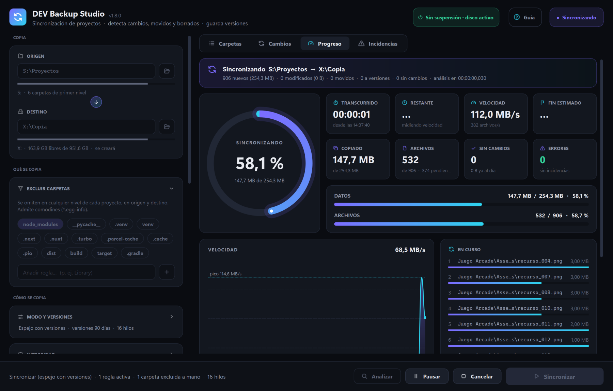
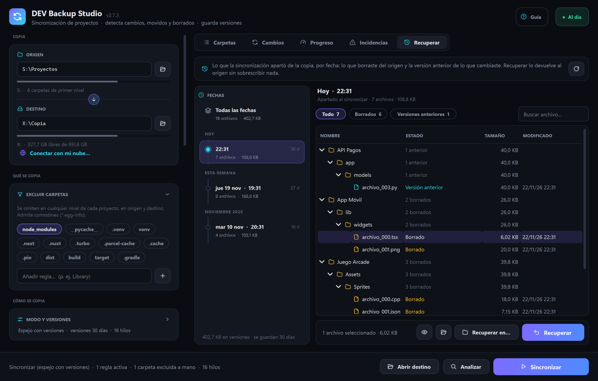
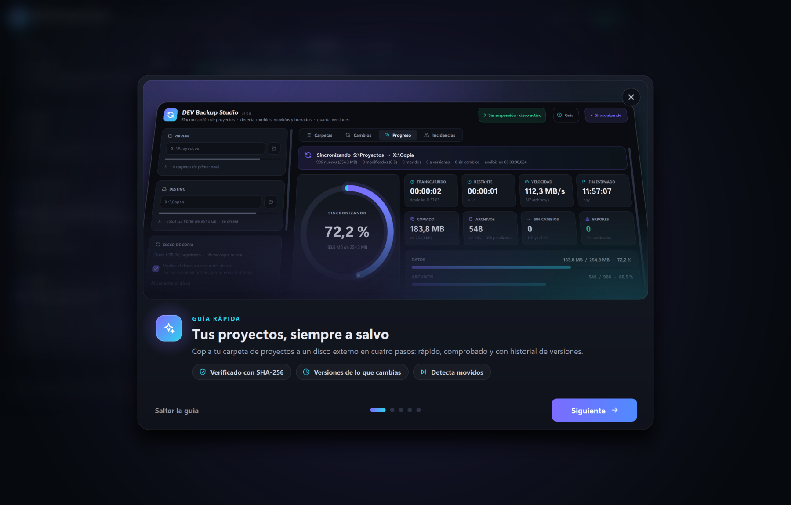

<p align="center">
  
</p>

<p align="center"><b>Español</b> · <a href="README.de.md">Deutsch</a></p>

Copia de seguridad y sincronización de carpetas de proyectos a un disco externo, para Windows, macOS y Linux.
Detecta qué ha cambiado, mueve lo renombrado en vez de volver a copiarlo, guarda versiones de lo que
borras o modificas, comprueba cada copia con SHA-256 y te pregunta si quieres sincronizar en cuanto
conectas el disco.

## Descargar e instalar

En [Releases](https://github.com/crazyramirez/dev-backup-studio/releases/latest):

| Sistema | Archivo | Instalación |
|---|---|---|
| Windows 10/11 (64 bits) | `DEV-Backup-Studio-Setup-x.y.z.exe` | Asistente de instalación. Por defecto se instala para tu usuario, sin pedir permisos de administrador; crea el acceso en el menú Inicio (y en el escritorio si lo marcas) y se desinstala desde *Configuración → Aplicaciones*. |
| macOS 12+ (Apple Silicon) | `DEV-Backup-Studio-x.y.z-macOS.dmg` | Abre el `.dmg` y arrastra la app a *Aplicaciones*. |
| Linux x86_64 (Ubuntu 22.04+, Debian 12+, Fedora 36+…) | `DEV-Backup-Studio-x.y.z-x86_64.AppImage` | Un solo archivo, sin instalar: guárdalo donde quieras (por ejemplo `~/Aplicaciones`), dale permiso de ejecución (*Propiedades → Permitir ejecutar*, o `chmod +x`) y ábrelo. Al abrirlo se añade solo al menú de aplicaciones. |
| Plesk Obsidian 18 (Linux) | `DEV-Backup-Studio-Plesk-x.y.z.zip` | La extensión para hacer copias de tus servidores Plesk (ver [Copias de servidores Plesk](#copias-de-servidores-plesk)). |

Para actualizar, instala la versión nueva encima: si la app está abierta (también en la bandeja), el
asistente pide cerrarla antes. Los ajustes, índices y copias se conservan, también al desinstalar. La
app avisa cuando hay una versión nueva y, si aceptas, se actualiza sola (en Linux sustituye el
`.AppImage` donde esté).

En Linux, la bandeja del sistema funciona en KDE, XFCE, Cinnamon, MATE y Ubuntu; en GNOME sin
modificar hace falta la extensión *AppIndicator*. Sin bandeja, la app arranca con la sesión minimizada.
Para quitarla: borra el `.AppImage`, `~/.local/share/applications/dev-backup-studio.desktop` y, si lo
activaste, `~/.config/autostart/dev-backup-studio.desktop`.

Las aplicaciones no están firmadas con un certificado de desarrollador, así que el sistema avisa la
primera vez:

- **Windows** (SmartScreen): *Más información* → *Ejecutar de todas formas*.
- **macOS**: clic derecho sobre la app → *Abrir*, o *Ajustes del Sistema → Privacidad y seguridad →
  Abrir igualmente*.



## Qué hace

- **Sincronización en espejo con versiones.** El destino queda igual que el origen. Lo que modificas o
  borras no se pierde: la versión anterior pasa a `.devbackup/versiones/<fecha>/` en el propio disco de
  copia y se conserva el tiempo que elijas (7, 30 o 60 días). Luego se quita sola, y antes si falta
  espacio para copiar: primero las más antiguas.
- **Recuperar, como una máquina del tiempo.** La pestaña *Recuperar* enseña lo apartado por fecha
  (hoy, ayer, esta semana, por meses) o todo junto, con buscador y filtros *Borrados* y *Versiones
  anteriores*. Un clic devuelve archivos o carpetas enteras a su sitio en el origen, o a otra carpeta.
  Nunca sobrescribe: si ya hay un archivo distinto con ese nombre, la versión se guarda al lado como
  `nombre (recuperado <fecha>).ext`.

  

- **Protección contra borrados masivos.** Si una sincronización va a apartar una parte grande de la
  copia (por ejemplo, porque el origen aparece vacío o un disco no está bien conectado), se detiene
  antes de tocar nada, enseña qué carpetas desaparecen y pregunta.
- **Detecta movidos y renombrados.** Una carpeta renombrada o movida a otra subcarpeta se mueve
  dentro del disco en segundos en lugar de copiarse otra vez, incluidos sus archivos repetidos
  (varios `__init__.py` vacíos, `.gitkeep`…) y aunque no tenga ningún archivo único. Las subcarpetas que habías excluido a mano siguen excluidas con el nombre nuevo, y
  un cambio solo de mayúsculas (`proyecto` → `Proyecto`) también se aplica a la copia.
- **Excluye lo que se regenera.** `node_modules`, `.venv`, `__pycache__`, `dist`… por nombre en
  cualquier nivel, o carpetas concretas desmarcándolas en el árbol.
- **Reconoce el disco al conectarlo.** Se queda en la bandeja (o en la barra de menús en macOS), y al
  enchufar el disco analiza y enseña qué hay nuevo, modificado, movido o borrado antes de copiar nada.
  Lo reconoce aunque Windows le dé otra letra.
- **Verifica cada copia.** Relee del disco cada archivo copiado, sin pasar por la caché del sistema, y
  compara su SHA-256 con el original. Si no coincide, repite la copia.
- **Revisa la integridad del disco poco a poco.** Tras cada sincronización, y durante el tiempo que
  elijas (5 minutos por defecto, sin pasarse aunque haya un archivo enorme a medias), comprueba una
  tanda de archivos ya copiados para detectar corrupción silenciosa: primero los nunca comprobados y
  luego los comprobados hace más de 30 días. Si el dañado es el destino, lo repara desde el original;
  si es el original, avisa y no toca la copia buena. Se puede omitir en cualquier momento: la copia ya
  está completa.
- **Progreso exacto y resumen al terminar.** Porcentaje, velocidad, tiempo restante, hora de fin,
  archivos en curso por hilo y duración final al milisegundo. Al acabar, un resumen con los archivos
  nuevos, modificados, movidos y pasados a versiones, las carpetas creadas y quitadas, lo que ya estaba
  al día y lo verificado. Pausa, cancelación y reanudación sin dejar archivos a medias.
- **Admite una unidad entera como origen.** Si el origen es la raíz de un disco (`F:\`), se omiten la
  papelera (`$RECYCLE.BIN`), `System Volume Information` y las carpetas de sistema de macOS.
- **Copia también en una carpeta de red.** El destino puede ser una carpeta compartida de otro equipo
  de casa, por ejemplo la carpeta `DEV_Backup_Studio` de [Personal Cloud Storage](#juntos-con-personal-cloud-storage): una unidad de red (`Z:`) o la
  ruta `\\nube.local\DEV_Backup_Studio\MiPC` en Windows, el recurso montado en `/Volumes` en macOS o una carpeta
  de red abierta desde el gestor de archivos en Linux. Antes de tocarla comprueba en un segundo que el servidor responde, así que un servidor apagado no deja la app
  esperando. Al volver a la red se ofrece sincronizar, como al conectar el disco.
- **Se conecta a Personal Cloud Storage con un código.** *Conectar con mi nube…* encuentra la nube en
  la red y pide el código de 6 cifras de su web. Guarda la credencial en el sistema y pone el destino
  solo: no hay que escribir direcciones ni contraseñas. En Linux monta la carpeta con GVFS (como al
  abrir `smb://` en el gestor de archivos, sin permisos de administrador), guarda la credencial en un
  archivo que solo puede leer tu usuario (`~/.config/DEV Backup Studio/nube-credenciales.json`) y la
  vuelve a montar sola tras reiniciar, en cuanto la nube responde.
- **No deja que nada pare la copia.** Mientras analiza o sincroniza, el equipo no se suspende por
  inactividad y el disco USB no se duerme. Apagar o reiniciar pide confirmación: en Windows aparece
  «Copia de seguridad en curso», y en macOS lo pide la propia app (en Linux se usa `systemd-inhibit`
  para no suspender). Si el equipo se suspende igualmente
  o el disco se desconecta, la copia espera y sigue sola sin dar nada por fallido. Se desactiva en
  *Energía*.
- **Te recuerda copiar.** Apunta cada copia que haces (origen y disco) y, si pasan los días que elijas
  con cambios sin copiar, te avisa una vez por periodo: «Tienes cambios sin copiar en DEV · 37 archivos
  desde tu última copia, hace 4 días». Comprueba sin abrir archivos; si no has tocado nada, no avisa.
  Con el disco conectado, se sincroniza desde el propio aviso.
- **En siete idiomas.** Español, inglés, francés, alemán, italiano, chino y japonés: automático según el
  sistema o elegido en *Sistema → Idioma*.
- **Guía rápida.** La primera vez enseña en seis pasos, con capturas de la propia app, cómo dejarla
  lista: origen y destino (disco o nube), qué copiar, analizar y sincronizar, recuperar lo borrado y
  conectar el disco. Tras una actualización con novedades importantes vuelve a salir una vez. Se vuelve a abrir con el botón *Guía*, con F1 (⌘? en macOS) o desde el icono de la bandeja.
- **Se actualiza sola, preguntando.** Comprueba en GitHub si hay una versión nueva (como mucho una vez
  al día), enseña las novedades y, si aceptas, descarga el instalador, comprueba su SHA-256, lo instala
  y se vuelve a abrir. Se puede desactivar o buscar a mano en *Actualizaciones*. Novedades de cada
  versión en [CHANGELOG.md](CHANGELOG.md).

| Al conectar el disco | Revisar los cambios antes de copiar |
|---|---|
|  |  |



## Juntos con Personal Cloud Storage

[Personal Cloud Storage](https://github.com/crazyramirez/personal-cloud-storage) es una nube
personal que montas en casa con una Raspberry Pi (o un mini PC) y un disco USB, sin servicios de
terceros. DEV Backup Studio puede hacer las copias de tus ordenadores **en esa nube, por la red de
casa**, en lugar de, o además de, un disco USB.

Así se suman lo mejor de las dos:

- **Tus proyectos llegan a la nube solos.** DEV Backup Studio copia lo que ha cambiado, guarda
  versiones de lo que modificas o borras y comprueba cada archivo con SHA-256. Ya no tienes que
  conectar un disco: basta con estar en casa (o en Tailscale).
- **Ves y descargas tus copias desde cualquier dispositivo**: el móvil, otro ordenador, el navegador.
  Están en la carpeta `DEV_Backup_Studio` de la nube, una por ordenador.
- **Tres copias sin esfuerzo.** El original en tu ordenador, la copia en la nube y, si usas la copia
  de seguridad en disco externo de Personal Cloud Storage, una tercera en otro disco.

Conectarlas es cosa de un minuto, sin escribir direcciones ni contraseñas:

1. En la nube, activa la carpeta de red una vez:
   `sudo bash /opt/pcloud/current/deploy/linux/setup/pcloud-install-smb.sh --execute`
   ([cómo](https://github.com/crazyramirez/personal-cloud-storage/blob/main/docs/OPERATIONS.md#8-quinquies-carpeta-de-red-para-copias-de-los-ordenadores-smb-opcional)).
2. En la web de la nube: *Ajustes → Copias de tus ordenadores → Conectar un ordenador*. Aparece un
   código de 6 cifras.
3. En DEV Backup Studio, debajo del destino: *Conectar con mi nube…* La app encuentra la nube en la
   red; escribe el código y pulsa *Conectar*. El destino queda puesto en la carpeta de este ordenador.

Si la nube está apagada o fuera de alcance, la app lo dice en un segundo y ofrece sincronizar en
cuanto vuelve, igual que al conectar un disco.

## Copias de servidores Plesk

En la pestaña **Plesk** la app guarda en tu disco de copia una **copia completa de tus servidores
Plesk**: ajustes del servidor, suscripciones, webs, bases de datos, correo y DNS. No es una copia a su
manera: la hace el propio Plesk con su herramienta oficial (`plesk bin pleskbackup --server`), así que
se restaura como cualquier copia de Plesk.

Para conectar un servidor no hacen falta contraseñas ni acceso por SSH:

1. Descarga `DEV-Backup-Studio-Plesk-x.y.z.zip` de
   [Releases](https://github.com/crazyramirez/dev-backup-studio/releases/latest) y súbelo en Plesk:
   *Extensiones → Mis extensiones → Subir extensión* (o `plesk bin extension --install archivo.zip`).
   Plesk esconde ese botón por defecto: para verlo, añade a `/usr/local/psa/admin/conf/panel.ini`
   (o con la extensión *Panel.ini Editor*) las líneas `[ext-catalog]` y `extensionUpload = true`.
2. Abre la extensión *DEV Backup Studio* y pulsa *Conectar un ordenador*: aparece un código de 6
   cifras (sirve una vez y caduca a los 10 minutos).
3. En la app, pestaña *Plesk → Conectar servidor…*: escribe la dirección del panel (el puerto 8443 se
   pone solo) y el código.

Cada ordenador recibe su propia llave, que se puede quitar en cualquier momento desde la extensión.
Si el panel usa el certificado propio de Plesk (no uno de Let's Encrypt u otra autoridad), la app
enseña su huella SHA-256 —la misma que muestra la extensión junto al código— y, una vez aceptada, la
fija: con otro certificado no se conecta.

**Copiar.** *Copiar ahora*, o automática cada día o cada semana mientras la app está abierta (o en la
bandeja) y el disco de copia conectado. Plesk prepara la copia en el servidor; la app la descarga
(si se corta, sigue donde iba), comprueba su SHA-256 y la guarda en `PLESK/<servidor>/` en la **raíz
del disco de copia**, una carpeta con el icono de Plesk. Después se borra del servidor. Se conservan
las 3, 7, 14 o 30 últimas. La sincronización de tus proyectos nunca toca la carpeta `PLESK`, aunque el
destino sea la raíz del disco.

**Restaurar.** Elige una copia y pulsa *Restaurar…*. Se sube al servidor que elijas y:

- **Subirla al Gestor de copias de seguridad de Plesk** no cambia nada: luego, en Plesk, restauras lo
  que quieras (todo, una suscripción, una base de datos…).
- **Restaurar todo el servidor** usa la restauración oficial, `plesk bin pleskrestore --restore …
  -level server`. Sirve también para pasar todo a un servidor nuevo: instala la extensión allí,
  conéctalo y restaura en él.

Plesk cifra las contraseñas que guarda la copia (buzones, bases de datos, FTP…) con una contraseña
que la app crea para cada servidor y recuerda. Anótala (*Contraseña…*): la pedirá Plesk si restauras
desde otro ordenador o subes la copia a mano en su Gestor de copias. Las copias son archivos `.tar`
normales de Plesk, así que también se pueden subir y restaurar a mano sin la app.

## Cómo decide qué copiar

Un archivo ha cambiado si es distinto su **tamaño o su fecha de modificación**, igual que robocopy,
rsync o FreeFileSync en su modo por defecto. En NTFS y APFS la fecha se compara al nanosegundo, así que
se detecta incluso una edición que no cambia el tamaño; en FAT/exFAT se admite su margen de 2 s.

Para no releer todo el disco externo cada día, al terminar se guarda un índice (SQLite) con el estado
del destino. El análisis diario compara el origen con ese índice y solo toca el disco para lo que ha
cambiado. Cada 7 días, o si cambia la configuración, se lee el destino entero.

| | Detecta cambios por | Borrados | Renombrados | Historial |
|---|---|---|---|---|
| robocopy /MIR | tamaño + fecha | se eliminan | se vuelven a copiar | no |
| rsync | tamaño + fecha (o contenido) | `--delete` | se vuelven a copiar | con `--backup-dir` |
| FreeFileSync | tamaño + fecha, con base de datos | a versiones | se detectan | sí |
| restic / Borg | contenido por bloques | instantáneas | sin coste | sí, pero hay que restaurar para ver los archivos |
| **DEV Backup Studio** | tamaño + fecha exacta, con índice | a versiones | se detectan | sí, archivos normales que se abren tal cual |

## Dónde guarda cada cosa

- **En el disco de copia**: carpeta oculta `.devbackup/` en la raíz con la marca del disco
  (`disco.json`), el historial de copias, las versiones y `latido`, el archivo diminuto que mantiene
  despierto el disco. Las copias de Plesk, en `PLESK/<servidor>/` (un `.tar` y un `.json` con su
  SHA-256 por copia).
- **En el equipo**: ajustes (con las copias habituales de los recordatorios), índices y registros en
  `%APPDATA%\DEV Backup Studio` (Windows), `~/Library/Application Support/DEV Backup Studio` (macOS) o
  `~/.config/DEV Backup Studio` (Linux). Las llaves de los servidores Plesk y las contraseñas de sus
  copias van aparte, en `plesk.json` (en Windows cifradas con DPAPI; en macOS y Linux, legibles solo
  por tu usuario).

## Ejecutar desde el código

```bash
pip install -r requirements.txt
python backup_studio.py
```

`python backup_studio.py --selftest` hace una sincronización de prueba completa sin ventana (copia,
verificación, movidos y reparación) y deja el resultado en `selftest.log`.

## Compilar

Al publicar una etiqueta `v*` (que debe coincidir con `APP_VERSION` en `backup_studio.py` y tener su
sección en `CHANGELOG.md`, de donde salen las notas de la versión), GitHub Actions:

1. compila la app con PyInstaller en Windows, macOS y Linux y ejecuta la autoprueba sobre cada una;
2. en Windows crea el instalador con Inno Setup (`installer/windows.iss`), lo instala sin ventanas,
   repite la autoprueba con la app instalada y la desinstala;
3. en macOS empaqueta la `.app` en un `.dmg`;
4. en Linux (Ubuntu 22.04) crea el `.AppImage` (`installer/linux/build-appimage.sh`) y repite la
   autoprueba con él;
5. comprueba la extensión de Plesk (`php -l`, `bash -n`) y la empaqueta
   (`python tools/build_plesk_extension.py`, código en `plesk-extension/`);
6. publica la versión con el instalador, el `.dmg`, el `.AppImage` y la extensión de Plesk.

```bash
git tag v1.8.0
git push origin v1.8.0
```

Los textos se traducen con `locales/<idioma>.json` (lista de textos: `python tools/i18n_extract.py`,
comprobación: `--check`). Las ilustraciones de la guía rápida (`assets/tour/<idioma>/`) y las capturas de los README (`docs/` y
`docs/de/` para `README.de.md`) se generan con capturas reales
de la app: `python tools/make_tour.py` (Windows; monta datos de ejemplo con `subst`).

## Limitaciones

- Una copia en un solo disco no protege de un incendio o un robo: para eso hace falta además una copia
  fuera de casa.
- Las versiones guardan el archivo completo (no hay deduplicación por bloques como en restic).
- La versión de macOS se compila para Apple Silicon y la de Linux para x86_64.
- La extensión de Plesk es para Plesk Obsidian en Linux (no Plesk para Windows). Las copias son
  completas, no incrementales, y el servidor necesita sitio libre para prepararlas. Plesk y su logotipo
  son marcas de sus propietarios; esta app no está afiliada a Plesk.
- En Linux, *Conectar con mi nube…* necesita GVFS con su módulo SMB (`gvfs-backends` en Ubuntu y
  Debian, `gvfs-smb` en Fedora y Arch), que traen GNOME, Cinnamon, MATE y XFCE. En KDE hay que
  instalarlo; si falta, la app lo dice.
- Linux distingue mayúsculas y los discos FAT, exFAT y NTFS no: si en una misma carpeta hay
  `Foto.jpg` y `foto.jpg` y el destino es uno de esos discos, solo se copia uno y el otro aparece como
  error.
