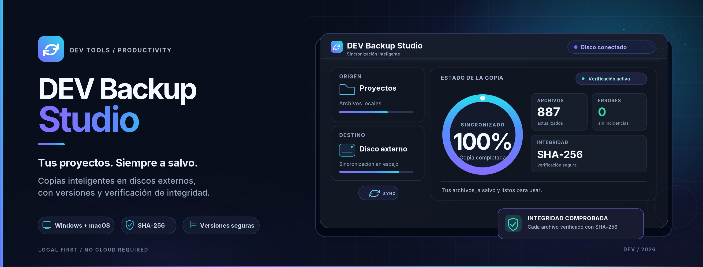
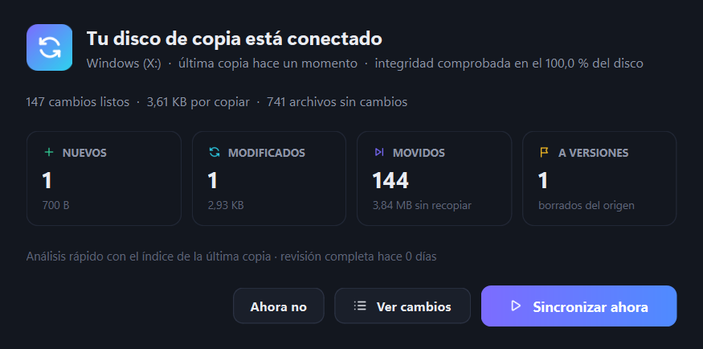
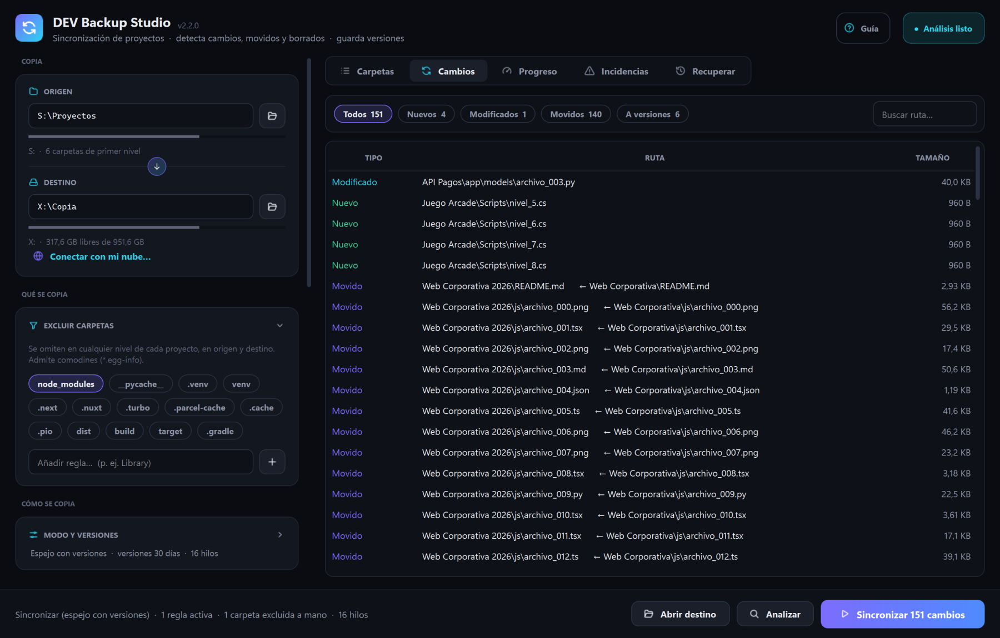

<p align="center">
  
</p>

Copia de seguridad y sincronización de carpetas de proyectos a un disco externo, para Windows y macOS.
Detecta qué ha cambiado, mueve lo renombrado en vez de volver a copiarlo, guarda versiones de lo que
borras o modificas, comprueba cada copia con SHA-256 y te pregunta si quieres sincronizar en cuanto
conectas el disco.

## Descargar e instalar

En [Releases](https://github.com/crazyramirez/dev-backup-studio/releases/latest):

| Sistema | Archivo | Instalación |
|---|---|---|
| Windows 10/11 (64 bits) | `DEV-Backup-Studio-Setup-x.y.z.exe` | Asistente de instalación. Por defecto se instala para tu usuario, sin pedir permisos de administrador; crea el acceso en el menú Inicio (y en el escritorio si lo marcas) y se desinstala desde *Configuración → Aplicaciones*. |
| macOS 12+ (Apple Silicon) | `DEV-Backup-Studio-x.y.z-macOS.dmg` | Abre el `.dmg` y arrastra la app a *Aplicaciones*. |

Para actualizar, instala la versión nueva encima: si la app está abierta (también en la bandeja), el
asistente pide cerrarla antes. Los ajustes, índices y copias se conservan, también al desinstalar.

Las aplicaciones no están firmadas con un certificado de desarrollador, así que el sistema avisa la
primera vez:

- **Windows** (SmartScreen): *Más información* → *Ejecutar de todas formas*.
- **macOS**: clic derecho sobre la app → *Abrir*, o *Ajustes del Sistema → Privacidad y seguridad →
  Abrir igualmente*.


## Qué hace

- **Sincronización en espejo con versiones.** El destino queda igual que el origen. Lo que modificas o
  borras no se pierde: la versión anterior pasa a `.devbackup/versiones/<fecha>/` en el propio disco de
  copia y se conserva el tiempo que elijas (30 días, 90 días, 1 año o siempre).
- **Detecta movidos y renombrados.** Una carpeta renombrada se mueve dentro del disco en segundos en
  lugar de copiarse otra vez.
- **Excluye lo que se regenera.** `node_modules`, `.venv`, `__pycache__`, `dist`… por nombre en
  cualquier nivel, o carpetas concretas desmarcándolas en el árbol.
- **Reconoce el disco al conectarlo.** Se queda en la bandeja (o en la barra de menús en macOS), y al
  enchufar el disco analiza y enseña qué hay nuevo, modificado, movido o borrado antes de copiar nada.
  Lo reconoce aunque Windows le dé otra letra.
- **Verifica cada copia.** Relee del disco cada archivo copiado, sin pasar por la caché del sistema, y
  compara su SHA-256 con el original. Si no coincide, repite la copia.
- **Revisa la integridad del disco poco a poco.** Tras cada sincronización comprueba una tanda de
  archivos ya copiados (primero los nunca comprobados) para detectar corrupción silenciosa. Si el
  dañado es el destino, lo repara desde el original; si es el original, avisa y no toca la copia buena.
- **Progreso exacto.** Porcentaje, velocidad, tiempo restante, hora de fin, archivos en curso por hilo
  y duración final al milisegundo. Pausa, cancelación y reanudación sin dejar archivos a medias.
- **No deja que nada pare la copia.** Mientras analiza o sincroniza, el equipo no se suspende por
  inactividad y el disco USB no se duerme. Apagar o reiniciar pide confirmación: en Windows aparece
  «Copia de seguridad en curso», y en macOS lo pide la propia app. Si el equipo se suspende igualmente
  o el disco se desconecta, la copia espera y sigue sola sin dar nada por fallido. Se desactiva en
  *Energía*.
- **Se actualiza sola, preguntando.** Comprueba en GitHub si hay una versión nueva (como mucho una vez
  al día), enseña las novedades y, si aceptas, descarga el instalador, comprueba su SHA-256, lo instala
  y se vuelve a abrir. Se puede desactivar o buscar a mano en *Actualizaciones*. Novedades de cada
  versión en [CHANGELOG.md](CHANGELOG.md).

| Al conectar el disco | Revisar los cambios antes de copiar |
|---|---|
|  |  |

## Cómo decide qué copiar

Un archivo ha cambiado si es distinto su **tamaño o su fecha de modificación**, igual que robocopy,
rsync o FreeFileSync en su modo por defecto. En NTFS y APFS la fecha se compara al nanosegundo, así que
se detecta incluso una edición que no cambia el tamaño; en FAT/exFAT se admite su margen de 2 s.

Para no releer todo el disco externo cada día, al terminar se guarda un índice (SQLite) con el estado
del destino. El análisis diario compara el origen con ese índice y solo toca el disco para lo que ha
cambiado. Cada 7 días, o si cambia la configuración, se lee el destino entero.

| | Detecta cambios por | Borrados | Renombrados | Historial |
|---|---|---|---|---|
| robocopy /MIR | tamaño + fecha | se eliminan | se vuelven a copiar | no |
| rsync | tamaño + fecha (o contenido) | `--delete` | se vuelven a copiar | con `--backup-dir` |
| FreeFileSync | tamaño + fecha, con base de datos | a versiones | se detectan | sí |
| restic / Borg | contenido por bloques | instantáneas | sin coste | sí, pero hay que restaurar para ver los archivos |
| **DEV Backup Studio** | tamaño + fecha exacta, con índice | a versiones | se detectan | sí, archivos normales que se abren tal cual |

## Dónde guarda cada cosa

- **En el disco de copia**: carpeta oculta `.devbackup/` en la raíz con la marca del disco
  (`disco.json`), el historial de copias, las versiones y `latido`, el archivo diminuto que mantiene
  despierto el disco.
- **En el equipo**: ajustes, índices y registros en `%APPDATA%\DEV Backup Studio` (Windows) o
  `~/Library/Application Support/DEV Backup Studio` (macOS).

## Ejecutar desde el código

```bash
pip install -r requirements.txt
python backup_studio.py
```

`python backup_studio.py --selftest` hace una sincronización de prueba completa sin ventana (copia,
verificación, movidos y reparación) y deja el resultado en `selftest.log`.

## Compilar

Al publicar una etiqueta `v*` (que debe coincidir con `APP_VERSION` en `backup_studio.py` y tener su
sección en `CHANGELOG.md`, de donde salen las notas de la versión), GitHub Actions:

1. compila la app con PyInstaller en Windows y macOS y ejecuta la autoprueba sobre cada una;
2. en Windows crea el instalador con Inno Setup (`installer/windows.iss`), lo instala sin ventanas,
   repite la autoprueba con la app instalada y la desinstala;
3. en macOS empaqueta la `.app` en un `.dmg`;
4. publica la versión con el instalador y el `.dmg`.

```bash
git tag v1.3.0
git push origin v1.3.0
```

## Limitaciones

- Una copia en un solo disco no protege de un incendio o un robo: para eso hace falta además una copia
  fuera de casa.
- Las versiones guardan el archivo completo (no hay deduplicación por bloques como en restic).
- La versión de macOS se compila para Apple Silicon.
